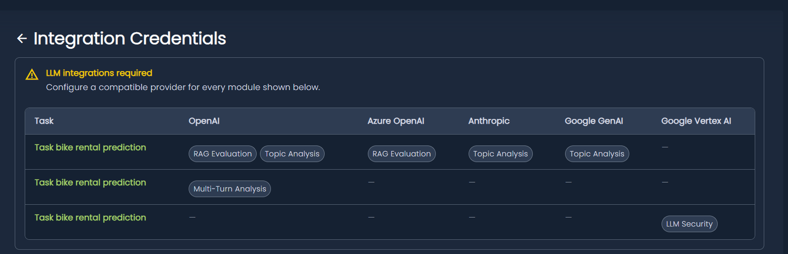

# Integrations
Below, you will find a guide that will help you create the credentials and configure the permissions that ML cube will use to access your resources on the supported cloud providers.

For LLM-powered analyses, configure a compatible provider in the project's **Integrations** page and allocate tokens through [LLM Usage](../llm_usage.md). Provider credentials and token allocations are separate settings.

## Integration warning

The **Integrations** menu displays an **Integration required** warning dot when at least one applicable LLM module in the project lacks a compatible provider integration. Open **Integrations** to see the **LLM integrations required** banner.

The banner lists the affected tasks in rows and compatible providers in columns. Each cell names the modules that the provider can satisfy for that task. A dash means that the provider is not compatible with the missing requirements in that row. Task names link to their task pages.

You do not need to configure every provider column. Configure **at least one compatible provider for each affected task/module**. A single integration can cover multiple modules and tasks in the same project. For example, OpenAI can satisfy both RAG Evaluation and Topic Analysis, while Multi-Turn Analysis additionally requires OpenRouter.

Task and module pages can also show a warning for their own missing integrations. Select **Open Integrations** to reach the project's credentials page.

<figure markdown>
  
  <figcaption>Missing integrations warning panel</figcaption>
</figure>

### Resolve the warning

1. Open the project's **Integrations** page and identify a compatible provider for each listed task/module.
2. Click **+ > AI**, choose a provider, enter its credentials, and click **Submit**. For OpenRouter, use the OpenAI form and select **OpenRouter** as the provider.
3. Review the warning again and configure any remaining providers needed by other modules.
4. Configure project and task allocations in [LLM Usage](../llm_usage.md).

!!! note
    This warning checks the presence of compatible provider credentials in the project. It does not test API keys, model access, or token limits. Changing usage limits does not resolve a missing-provider warning. Removing credentials can make the warning appear again.

## Required LLM integrations by module

The platform determines integration requirements from each task's configuration and the company's active licence. These are the modules that can require an LLM integration; they do not all apply to every task.

| Module | When the requirement applies | Compatible providers |
| --- | --- | --- |
| [Topic Analysis (Topic Modeling)](../modules/topic_modeling.md) | Text tasks with Monitoring and Topic Analysis licensed. | OpenAI, Azure OpenAI, Google GenAI, or Google Vertex AI. |
| [RAG Evaluation](../modules/rag_evaluation.md) | Text RAG tasks with Monitoring and RAG Evaluation licensed. | OpenAI, Azure OpenAI, Google GenAI, or Google Vertex AI. |
| [Multi-Turn Analysis](../modules/multi_turn.md) | Text RAG tasks with multi-turn enabled. The integration-status feature requires Monitoring. | OpenRouter. |
| [LLM Security](../modules/llm_security.md) | Text RAG tasks with Monitoring and LLM Security licensed. | Providers referenced in the LLM specifications of the task's models. Configure at least one of the compatible providers shown in the warning. |

LLM Security requirements depend on the task's model specifications. If no provider is specified, the current integration check does not raise a missing-provider warning for that module; this does not mean that its analysis data and model configuration are complete.

The warning recognises dedicated Google Vertex AI credentials. The GCP service-account setup in [GenAI Integration](#genai-integration) alone does not satisfy the current warning check.

For connection fields, permissions, weekly token limits, and scheduled allocations, see [LLM Usage](../llm_usage.md).

## Creating the credentials

=== "Amazon Web Services"
    {: style="height:50px;width:50px"}

    The ML cube Platform can assume an **IAM Role** on your AWS Account, that can be used to authorize actions on specific resources.
    
    You will need to create the credentials through the ML cube Platform SDK or the web application.

    !!! example
        The following code will create a set of AWS credentials for an IAM Role called `YOUR_ROLE_NAME` (change this as desired).

        ```py
        aws_creds = client.create_aws_integration_credentials(
            name='AWS_01',
            default=True,  # Set these credentials as the default to use when not specified
            project_id='your_project_id',
            role_arn='arn:aws:iam::{{YOUR_AWS_ACCOUNT_ID}}:role/{{YOUR_ROLE_NAME}}',
        )

        print(aws_creds.trust_policy)
        ```

    Now, log into your AWS account and open the AWS console. Here, go to the **IAM** service, navigate to the **Roles** section and create a new role. It is important to set the **trust policy** to the one you just obtained.

    Right now, your **IAM Role** grants no permissions. Please refer to the next sections that will explain how to set up **IAM Policies** for S3, Event Bridge and so on.

    To revoke access, simply delete the role or change the trust policy.

=== "Google Cloud Platform"
    {: style="height:50px;width:50px"}

    The ML cube Platform can operate in your GCP Account through the creation of a dedicated **Service Account**. You will then be able to assign one or more **IAM Roles** to this Service Account, to allow the ML cube Platform to perform specific actions.

    To configure a Service Account for ML cube Platform, log into your GCP account, select the correct project and open the **Cloud Shell**. You can find the button to open it in the upper-right corner of the page. Now we will enter some commands that will create the **Service Account** with the required permissions. A description of each command is provided to help you understand its purpose.

    ```bash
    # Change this according to your project
    export GCP_PROJECT=my-project

    # Creates a service account called ml3PlatformServiceAccount
    gcloud iam service-accounts create ml3PlatformServiceAccount --display-name "ML3 Platform Service Account"

    # Generates the access key that will be used to authenticate as the service account
    gcloud iam service-accounts keys create ml3-platform-key.json --iam-account=ml3PlatformServiceAccount@$GCP_PROJECT.iam.gserviceaccount.com

    # Displays the access key to the terminal screen
    cat ml3-platform-key.json
    ```

    Copy the JSON object containing the key and save it to a file with the same name on your disk.
    Now, you will need to create the GCP credentials, either through the SDK or the web application, and provide the contents of the JSON file you just created.

    !!! example
        The following code will create a set of GCP credentials that will be able to access the service account.

        ```py
        with open('path/to/ml3-platform-key.json', 'r') as f:
            creds_json = f.read()

            gcp_creds = client.create_gcp_integration_credentials(
                name='GCP_01',
                default=True,  # Set these credentials as the default to use when not specified
                project_id='your_project_id',
                service_account_info_json=creds_json
            )
        ```

    Right now, your **IAM Role** grants no permissions. Please refer to the next sections that will explain how to set up **IAM Policies** for Google Cloud Storage, Pub/Sub and so on.

=== "Microsoft Azure"
    {: style="height:50px;width:50px"}
    
    The ML cube Platform can operate in your Azure Account through the creation of a dedicated **Service Principal**. You will then be able to assign one or more **Roles** to this Service Principal, to allow the ML cube Platform to perform specific actions.

    To configure a Service Principal for ML cube Platform, log into your Azure account, select the correct project and open the **Cloud Shell**. You can find the button to open it in the upper-right corner of the page. Set the Cloud Shell to use bash instead of powershell. Now we will enter the following command that will create the **Service Principal**.

    ```bash
    az ad sp create-for-rbac --name ML3PlatformSP --skip-assignment
    ```

    Once the operation finishes running, it will output a JSON object with the following fields: `appId`, `displayName`, `password` and `tenant`. Copy this object and save it to a file on your disk, for example `azure-credentials.json`.

    Now, you will need to create the Azure credentials, either through the SDK or the web application, and provide the contents of the JSON file you just created.

    !!! example
        The following code will create a set of Azure credentials that will be able to access the service account.

        ```py
        with open('path/to/azure-credentials.json', 'r') as f:
            creds_json = f.read()

            azure_creds = client.create_azure_integration_credentials(
                name='AZURE_01',
                default=True,  # Set these credentials as the default to use when not specified
                project_id='your_project_id',
                service_principal_credentials_json=creds_json
            )
        ```

=== "AWS Compatible"
    {: style="height:50px;width:50px"}

    The ML cube Platform can be connected to AWS compatible services through security credentials.
    
    For example, to use min.io's S3-compatible storage, you can use the username and password of your min.io's user as the security credentials. You also need to provide the endpoint where your min.io instance can be reached.
    You will need to create the credentials through the ML cube Platform SDK or the web application.

    !!! example
        The following code will create a set of AWS-compatible credentials.

        ```py
        aws_compatible_creds = client.create_aws_compatible_integration_credentials(
            name='AWS_COMPATIBLE_01',
            default=True,  # Set these credentials as the default to use when not specified
            project_id='your_project_id',
            access_key_id='username',
            secret_access_key='password',
            endpoint_url='https://my-service.com:1234'
        )
        ```

    If `endpoint_url` is set to `None`, these credentials can be used to access AWS itself as an IAM User.

    !!! warning
        Using AWS-compatible credentials to access AWS itself is discouraged, and should only be used in special cases where you are not able to use an IAM Role.

## Storage integration

=== "AWS S3"
    {: style="height:50px;width:50px"}

    Log into your AWS account and open the AWS console, then go to the **IAM** service and navigate to the **Policies** section. Here, we will create an **IAM Policy**.

    !!! example
        The following policy will grant read access to objects in the `my-company-data-bucket` to the IAM entity it is attached to.

        ```json
        {
            "Version": "2012-10-17",
            "Statement": [
                {
                    "Sid": "Statement1",
                    "Effect": "Allow",
                    "Action": [
                        "s3:GetBucketTagging",
                        "s3:GetObject",
                        "s3:ListBucket"
                    ],
                    "Resource": [
                        "arn:aws:s3:::my-company-data-bucket",
                        "arn:aws:s3:::my-company-data-bucket/*"
                    ]
                }
            ]
        }
        ```

    Once the **IAM Policy** has been created, navigate to the **Roles** section, select the **IAM Role** you previously created and finally attach the **IAM Policy** to it.

=== "Google Cloud Storage"
    {: style="height:50px;width:50px"}

    Log into your GCP account, select the correct project and open the **Cloud Shell**. You can find the button to open it in the upper-right corner of the page. Now we will enter some commands that will create an **IAM Role** with the required permissions, bind it to the service account you previously created, and grant access to the bucket. A description of each command is provided to help you understand its purpose.

    ```bash
    # Change these according to your project and bucket
    export GCP_PROJECT=my-project
    export GCP_BUCKET=my-company-data-bucket

    # Creates an IAM Role called ml3PlatformStorageRole for your project, with read permissions on buckets and objects in the storage service
    gcloud iam roles create ml3PlatformStorageRole --project=$GCP_PROJECT --title="ML3 Platform Storage Role" --description="Role that allows the ML cube Platform to access storage resources in a project" --permissions=storage.buckets.get,storage.buckets.list,storage.objects.get,storage.objects.list --stage=ALPHA

    # Adds the IAM Role to the previously created service account
    gcloud projects add-iam-policy-binding $GCP_PROJECT --member=serviceAccount:ml3PlatformServiceAccount@$GCP_PROJECT.iam.gserviceaccount.com --role=projects/$GCP_PROJECT/roles/ml3PlatformStorageRole

    # Allows the service account we created to access the given bucket with the objectViewer role
    gsutil iam ch serviceAccount:ml3PlatformServiceAccount@$GCP_PROJECT.iam.gserviceaccount.com:roles/storage.objectViewer gs://$GCP_BUCKET
    ```

=== "Azure Blob Storage"
    {: style="height:50px;width:50px"}

    Log into your Azure account and open the **Cloud Shell**. You can find the button to open it in the upper-right corner of the page. The following command will associate the previously created Service Principal with a role that is able to read data from a given blob container.

    ```bash
    # Change these according to your project and storage configuration
    export SERVICE_PRINCIPAL_APP_ID=my-sp-app-id
    export SUBSCRIPTION_ID=my-azure-subscription-id
    export RESOURCE_GROUP=my-azure-resource-group
    export STORAGE_ACCOUNT=my-storage-account
    export BLOB_CONTAINER=my-blob-container

    az role assignment create --assignee $SERVICE_PRINCIPAL_APP_ID --role "Storage Blob Data Reader" --scope /subscriptions/$SUBSCRIPTION_ID/resourceGroups/$RESOURCE_GROUP/providers/Microsoft.Storage/storageAccounts/$STORAGE_ACCOUNT/blobServices/default/containers/$BLOB_CONTAINER
    ```

=== "AWS S3 Compatible"
    {: style="height:50px;width:50px"}

    Log into your AWS S3 compatible service and set up a policy that allows to access objects in the bucket of your choice.

    !!! example
        The following policy will grant read access to objects in the `my-company-data-bucket`.

        ```json
        {
            "Version": "2012-10-17",
            "Statement": [
                {
                    "Sid": "Statement1",
                    "Effect": "Allow",
                    "Action": [
                        "s3:GetBucketTagging",
                        "s3:GetObject",
                        "s3:ListBucket"
                    ],
                    "Resource": [
                        "arn:aws:s3:::my-company-data-bucket",
                        "arn:aws:s3:::my-company-data-bucket/*"
                    ]
                }
            ]
        }
        ```

        Adjust the policy according to the specifics of the S3-compatible service you are using.

    Make sure the policy is attached to the user whose credentials you are going to configure as AWS-compatible credentials in the ML cube platform.

## Retrain events integration

=== "Amazon EventBridge"
    {: style="height:50px;width:50px"}

    Log into your AWS account and open the AWS console, then go to the **IAM** service and navigate to the **Policies** section. Here, we will create an **IAM Policy**.

    !!! example
        The following policy will allow an **IAM Entity** to put events in a specific event bus.

        ```json
        {
            "Version": "2012-10-17",
            "Statement": [
                {
                    "Sid": "Statement1",
                    "Effect": "Allow",
                    "Action": [
                        "events:PutEvents"
                    ],
                    "Resource": [
                        "arn:aws:events:<REGION>:<ACCOUNT_ID>:event-bus/<EVENT_BUS_NAME>"
                    ]
                }
            ]
        }
        ```

        Replace `<REGION>`, `<ACCOUNT_ID>` and `<EVENT_BUS_NAME>` with your desired values.

    Once the **IAM Policy** has been created, navigate to the **Roles** section, select the **IAM Role** you previously created and finally attach the **IAM Policy** to it.

=== "GCP Pub/Sub"
    {: style="height:50px;width:50px"}

    Log into your GCP account, select the correct project and open the **Cloud Shell**. You can find the button to open it in the upper-right corner of the page. Now we will enter some commands that will create an **IAM Policy** with the required permissions, bind it to the service account you previously created, and grant access to the Pub/Sub topic. A description of each command is provided to help you understand its purpose.

    ```bash
    # Change these according to your project and topic
    export GCP_PROJECT=my-project
    export GCP_TOPIC=my-topic

    # Adds a new IAM Policy to the previously created service account, granting publish access to the Pub/Sub topic
    gcloud pubsub topics add-iam-policy-binding $GCP_TOPIC --member=serviceAccount:ml3PlatformServiceAccount@$GCP_PROJECT.iam.gserviceaccount.com --role=roles/pubsub.publisher
    ```

=== "Azure Event Grid"
    {: style="height:50px;width:50px"}

    Log into your Azure account and open the **Cloud Shell**. You can find the button to open it in the upper-right corner of the page. The following command will associate the previously created Service Principal with a role that is able to publish events to an Event Grid topic.

    ```bash
    # Change these according to your project and storage configuration
    export SERVICE_PRINCIPAL_APP_ID=my-sp-app-id
    export SUBSCRIPTION_ID=my-azure-subscription-id
    export RESOURCE_GROUP=my-azure-resource-group
    export TOPIC_ID=my-topic

    az role assignment create --assignee $SERVICE_PRINCIPAL_APP_ID --role "EventGrid Data Sender" --scope /subscriptions/$SUBSCRIPTION_ID/resourceGroups/$RESOURCE_GROUP/providers/Microsoft.EventGrid/topics/$TOPIC_ID
    ```

## GenAI Integration

Use this section to connect the project to the LLM providers used by its analysis modules. Check [Required LLM integrations by module](#required-llm-integrations-by-module) before choosing a provider: a provider can be supported by the platform without being compatible with every module.

### Common credential settings

In the project's **Integrations** page, click **+**, select **AI**, and open the provider's credentials form. OpenAI and OpenRouter share the **Add OpenAI Credentials** form; the other providers have dedicated forms.

All AI credential forms include the following settings:

| Setting | Description |
| --- | --- |
| Name | A name that identifies the credentials in this project, such as `OpenAI Production`. |
| API Key | The key issued by the selected provider. Use a key with access to the models needed by the analysis. |
| Priority | A positive integer, starting at `1`. A higher value means a higher priority. |
| Default | Select the checkbox to make the credentials the default for their credential type. |

Fill in the provider-specific fields described below and click **Submit**. The credentials appear as a card in the project. Use **Details** to review the configuration or set the credentials as default, and the card's delete control to remove them. Removing credentials from ML cube Platform does not revoke the key at the provider.

### Provider setup

=== "GCP Vertex AI"

    **API key (Express Mode)**

    1. Set up Express Mode in Google Cloud and obtain an API key from **APIs & Services > Credentials**. Follow the [Google Express Mode setup guide](https://cloud.google.com/vertex-ai/generative-ai/docs/start/express-mode/overview) for account and key setup.
    2. In ML cube Platform, open **Integrations > + > AI** and choose **Google Vertex AI**.
    3. Enter **Name**, **API Key**, and **Priority**, and optionally select **Make these my default Google Vertex AI credentials**.
    4. Click **Submit**.

    This form uses an Express Mode API key and does not request a GCP project ID, location, or service-account JSON. Use the service-account configuration below when you need that authentication method.

    **GCP service account**

    Create the service account and register its JSON credentials using the **Google Cloud Platform** instructions in [Creating the credentials](#creating-the-credentials). In the Google Cloud project, ensure the Vertex AI API is enabled, then grant the service account the **Vertex AI User** role. See [Google's Vertex AI access-control documentation](https://cloud.google.com/vertex-ai/docs/general/access-control).

    Log into your GCP account, select the correct project and open **Cloud Shell**. Run the following commands for the service account created earlier:

    ```bash
    # Change these according to your project
    export GCP_PROJECT=my-project

    # Grants the Vertex AI User role to the previously created service account, allowing it to use all resources in Vertex AI
    gcloud projects add-iam-policy-binding $GCP_PROJECT --member=serviceAccount:ml3PlatformServiceAccount@$GCP_PROJECT.iam.gserviceaccount.com --role=roles/aiplatform.user
    ```

    !!! note
        The current integration warning recognises dedicated Google Vertex AI API-key credentials. GCP service-account credentials alone do not clear the warning, even when the service account has Vertex AI permissions.

=== "OpenAI"

    1. Create an API key in the OpenAI API dashboard, following the [OpenAI developer quickstart](https://platform.openai.com/docs/quickstart).
    2. In ML cube Platform, open **Integrations > + > AI** and choose **OpenAI**.
    3. Enter **Name** and select **OpenAI** in the **Provider** field.
    4. Enter the **API Key**. The **Base URL** is automatically filled with `https://api.openai.com/v1`.
    5. Set **Priority**, optionally select **Make these my default OpenAI credentials**, and click **Submit**.

    The form also supports a custom base URL, for example for an OpenAI-compatible proxy. Keep the selected provider consistent with the endpoint you intend to use. Enter the API base URL rather than an individual request path such as `/chat/completions`.

=== "OpenRouter"

    1. Create an API key in your OpenRouter account. See the [OpenRouter quickstart](https://openrouter.ai/docs/quickstart).
    2. In ML cube Platform, open **Integrations > + > AI** and choose **OpenAI** to open the shared credentials form.
    3. Enter **Name** and select **OpenRouter** in the **Provider** field.
    4. Enter the OpenRouter **API Key**. The **Base URL** is automatically filled with `https://openrouter.ai/api/v1`.
    5. Set **Priority**, optionally select the default checkbox in the shared form, and click **Submit**.

    OpenRouter credentials are stored through the OpenAI-compatible integration. The current integration warning identifies OpenRouter by its official base URL. A custom proxy URL does not satisfy the OpenRouter requirement in that check.

    Multi-Turn Analysis requires OpenRouter. Selecting **OpenAI** with the OpenAI endpoint does not satisfy this requirement. The form rejects a selected provider paired with the other provider's official base URL.

=== "Azure OpenAI"

    1. Create an Azure OpenAI resource and deploy the model needed by your analysis. Follow [Microsoft's resource and deployment guide](https://learn.microsoft.com/en-us/azure/ai-services/openai/how-to/create-resource).
    2. Obtain the resource's API key and endpoint, and identify the API version supported by your configuration.
    3. In ML cube Platform, open **Integrations > + > AI** and choose **Azure OpenAI**.
    4. Enter **Name**, **API Version**, **Endpoint**, and **API Key**. The endpoint is the Azure OpenAI resource URL, for example `https://my-resource.openai.azure.com`.
    5. Set **Priority**, optionally select **Make these my default Azure OpenAI credentials**, and click **Submit**.

    Use the credentials of the Azure OpenAI resource that hosts your deployment. The credentials form does not include a deployment-name field; task/model configuration and access to the required deployment must also be in place. General Azure service-principal credentials used for storage do not replace this integration's API key.

=== "Anthropic"

    1. Obtain an API key from the Claude Console. See [Anthropic's API overview](https://docs.anthropic.com/en/api/overview) for account and key prerequisites.
    2. In ML cube Platform, open **Integrations > + > AI** and choose **Anthropic**.
    3. Enter **Name**, the Anthropic **API Key**, and **Priority**.
    4. Optionally select **Make these my default Anthropic credentials**, then click **Submit**.

    This integration connects to Anthropic's API for Claude models. The form does not request a base URL. Anthropic can satisfy LLM Security requirements when it is referenced in the task's model specifications; it is not among the compatible providers for RAG Evaluation, Topic Analysis, or Multi-Turn Analysis in the current integration check.

=== "Google GenAI"

    1. Create a Gemini API key in Google AI Studio for the appropriate Google Cloud project. Follow [Google's Gemini API-key guide](https://ai.google.dev/gemini-api/docs/api-key) for project selection and key requirements.
    2. In ML cube Platform, open **Integrations > + > AI** and choose **Google GenAI**.
    3. Enter **Name**, the Gemini **API Key**, and **Priority**.
    4. Optionally select **Make these my default Google GenAI credentials**, then click **Submit**.

    This form connects to Google's Generative AI API and does not request a base URL or service-account JSON. Google GenAI and Google Vertex AI are separate integrations; choose the form that matches the API and credentials you intend to use.

### After creating the credentials

Review the [integration warning](#integration-warning) and configure any remaining compatible providers. Then open [LLM Usage](../llm_usage.md) to allocate project and task token limits. Open the relevant module in your task to request an analysis using its documented data and model configuration.

If an analysis cannot access the provider, check the key, endpoint or API version where applicable, model access, and the provider account's quota. The integration warning checks configured provider types and does not validate those connection details.
