# LLM Usage

ML cube Platform uses large language models (LLMs) in [RAG Evaluation](modules/rag_evaluation.md), [Topic Modeling](modules/topic_modeling.md), [Multi-Turn Analysis](modules/multi_turn.md), and [LLM Security](modules/llm_security.md). Provider integrations supply the credentials for these analyses, while **LLM Usage** lets you allocate weekly token limits to projects and their tasks, follow the tokens consumed by their jobs, and keep the usage of whole weeks in reports.

## Before you start

The modules in ML cube Platform can require some LLM Provider integrations, see [Required LLM integrations by module](integrations/index.md#required-llm-integrations-by-module) for the provider requirements.

Configure credentials in the project's **Integrations** page, then configure usage limits as described below. Credentials belong to a project and can satisfy the requirements of multiple tasks in that project.

## Open the LLM Usage page

There are three views of the **LLM Usage** page, depending on the level you want to inspect and on the User role:

| View | Where to open it | What you can do |
| --- | --- | --- |
| Company | **LLM Usage** in the company settings menu | Manage project limits and task allocations across the company, and follow the usage of all the projects. Company owners and administrators can manage these limits and read the usage. |
| Project | **LLM Usage** in the project menu | Manage task allocations within the project limit and follow the usage of the project tasks. Project owners and administrators can manage task limits; project users and viewers can read them. Company owners and administrators can also manage them. |
| Task | **LLM Usage** in the task menu | Follow the usage of the task. The task view has no limits section. |

The company and project views are made of two collapsible sections:

- **Limits**: the token limits of the projects and of their tasks, described in [Understand limits and usage](#understand-limits-and-usage).
- **Usage**: the token consumption, with a **Live** tab and a **Reports** tab, described in [Follow the usage](#follow-the-usage).

The project view displays the project limit as a reference value. To change that limit, use the company view.

<figure markdown>
  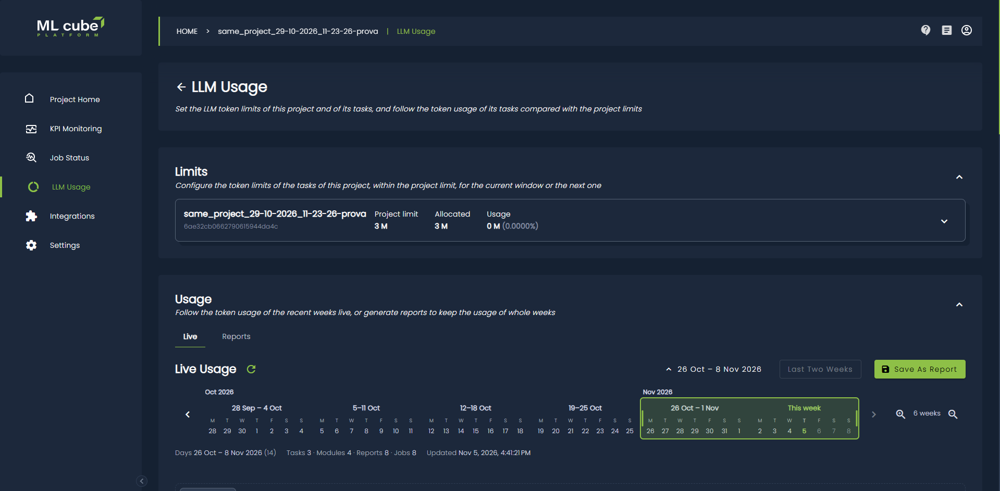
  <figcaption>LLM Usage page of a project</figcaption>
</figure>


## Understand limits and usage

The LLM usage limit is applied on window basis, the _current window_ refers to the present and the usage is compared against it, the _next window_ refers to the next iteration.
At the end of the current window the cumulative usage is reset.

The supported window timespan is **Week**, and the metric unit is **Million tokens**. For example, a limit of `2.5` represents 2,500,000 tokens. Limits express token quantities rather than monetary amounts.

New projects and tasks start with a limit of **0**. Assign limits explicitly before relying on a task's token allocation.

Expand a project card to review its settings:

| Field | Meaning |
| --- | --- |
| Project limit | The total token allocation available to distribute among the project's tasks. |
| Allocated | The sum of the task limits. |
| Unallocated limit | The project limit minus the sum of task limits. This balance is available for allocation to tasks. |
| Task limit | The token allocation for a task, shared by its LLM modules. |
| Usage / Current usage | The usage value supplied for the current window. Task rows include a usage bar. |
| Next project limit / Next allocation | The effective allocations for the next window when scheduled changes exist. |

The usage percentage in the collapsed project card compares task usage with the **allocated** total. Each task's usage bar compares its usage with its own limit.

<figure markdown>
  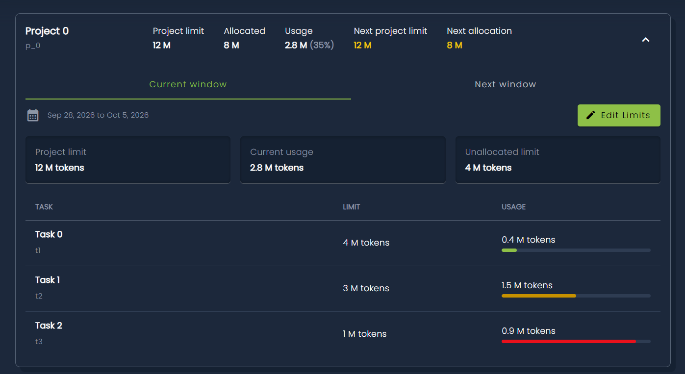
  <figcaption>Details of project limits</figcaption>
</figure>

## Edit current limits

!!! note
    Current window limits can only be changed if there are no limits configured for the next window.

1. Expand the project and click **Edit limits**.
2. Select **Current window** under **Apply changes to**.
3. In the company view, set the **Project limit**. In either view, enter the **Task limits** in million tokens.
4. Check the unallocated balance and click **Save limits**.

The sum of all task limits must not exceed the project limit. For a current-window change, each positive task limit must also be at least **120% of the task's reported current usage**. A zero task limit is permitted.

For example, a project limit of `5` can cover task limits of `2` and `1.5`, leaving `1.5` million tokens unallocated. If a task's reported usage is `1`, its positive current-window limit must be at least `1.2`.

Current-window changes take effect immediately. Editing an allocation does not start a new usage week.

<figure markdown>
  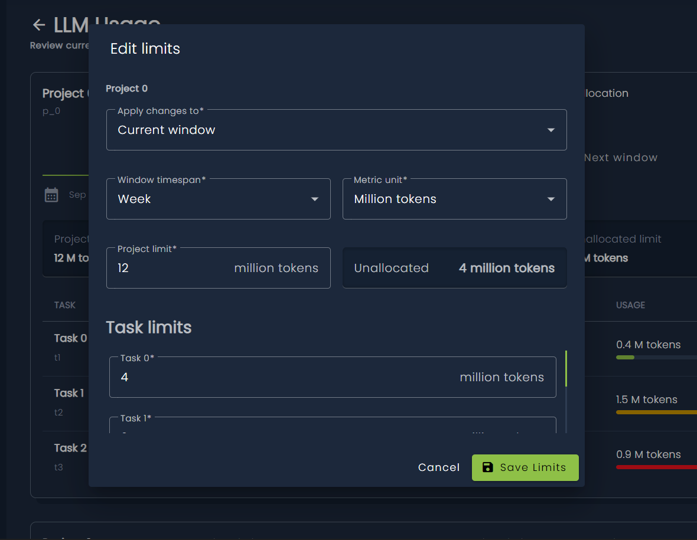
  <figcaption>Edit current window limits</figcaption>
</figure>

## Schedule the next window

To prepare future allocations, click **Edit limits**, choose **Next window** under **Apply changes to**, enter the limits, and click **Save limits**. Scheduled changes activate at midnight on the next Monday according to UTC time reference.

Once changes are scheduled, expand the project to switch between **Current window** and **Next window**. A notification dot marks scheduled limits. Values without a scheduled replacement retain their current allocation. The next-window view shows allocations without current usage bars.

Use **Edit limits** in the **Next window** tab to revise the schedule. Next-window allocations must still fit within the project limit; the current-usage 120% rule applies only to current-window changes.

Use **Cancel** in the next-window view to cancel scheduled changes. The company view cancels both project and task changes for that project. The project view cancels only task changes; a scheduled project limit remains, and the restored task allocations must fit within it.

<figure markdown>
  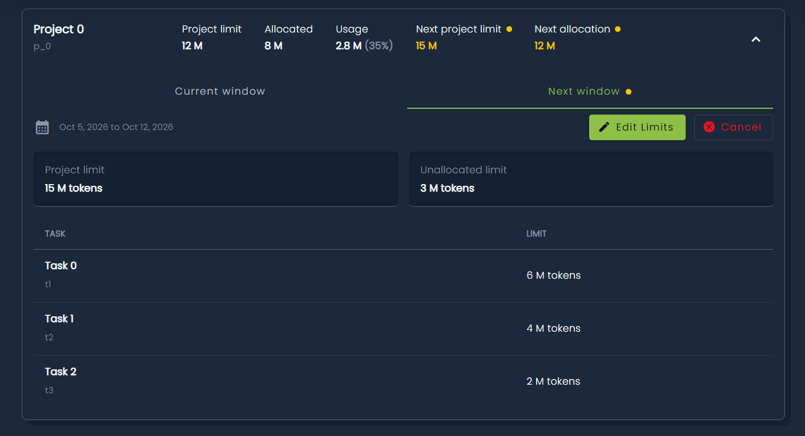
  <figcaption>Next window limits</figcaption>
</figure>

## Follow the usage

The **Usage** section shows the tokens consumed by the LLM calls of the jobs of a task, a project, or the whole company. Usage is counted per UTC day and grouped in weeks from Monday to Sunday, the same windows used by the limits.

Two tabs are available:

| Tab | What it shows |
| --- | --- |
| **Live** | The usage of a short range of recent days, computed on request every time the tab is opened or refreshed. Nothing is stored. |
| **Reports** | The reports generated for whole weeks. A report keeps the usage computed when it is generated, so it can be opened, compared, and exported later. |

Both tabs can go back up to **52 weeks**, the current week included.

!!! note
    Reading the usage of a task or a project requires at least the project viewer role. Reading the usage of the whole company requires the company owner or administrator role.

### Live usage

The **Live** tab shows the previous week and the current one by default. Click the range label to open the week strip and choose other weeks:

- Drag the highlighted window to move it, or drag its edges to resize it.
- Use the arrows to show older or newer weeks, and the zoom buttons to show fewer or more weeks in the strip.
- With the keyboard, use the arrow keys to move the window and **Shift** + arrow keys to resize it.

The live usage covers at most **4 weeks** (28 days). Select **Last two weeks** to go back to the default range, and the refresh icon to load the latest usage.

To keep the usage of the selected weeks, select **Save as report**: the **New LLM usage report** panel opens with the same weeks, see [Generate a report](#generate-a-report).

<figure markdown>
  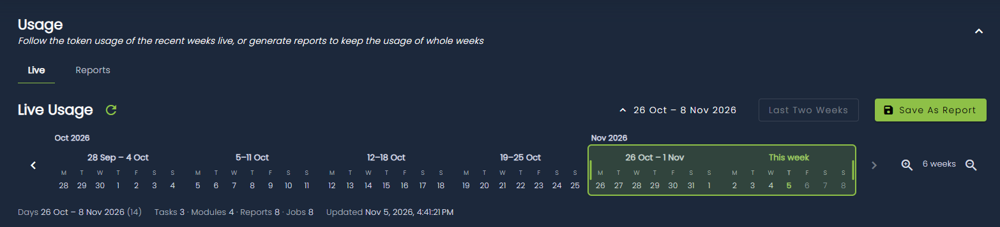
  <figcaption>Live tab with the week strip open</figcaption>
</figure>

### Generate a report

1. Open the **Reports** tab and select **Generate report**. The **New LLM usage report** panel opens on the side of the page.
2. Enter the **Report name**, up to 256 characters.
3. Choose the **Time range**: **1 week**, **4 weeks**, or **12 weeks** ending with the current week, or **Custom**. Choosing a preset also fills in a default name, for example `Last 4 weeks`.
4. For a custom range, click the first week in the calendar, then the last one. The current week is outlined.
5. Check the selected weeks shown above the calendar and select **Generate report**.

A report always covers whole weeks, from the Monday of the first week to the Sunday of the last one, and can span at most 52 weeks.

!!! warning
    When the range includes the current week, the report contains only the usage up to the moment it is generated. Generate it again once the week is over to have the full usage.

The report is computed in the background. Generating a task or project report requires permission to work on the project; generating a company report requires the company owner or administrator role.

<figure markdown>
  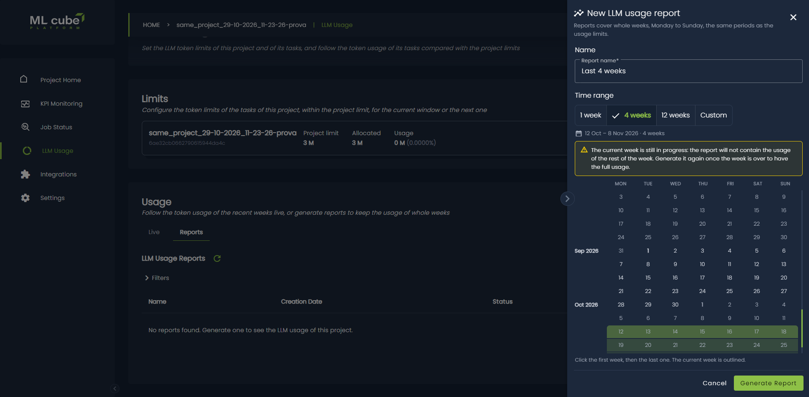
  <figcaption>New LLM usage report panel</figcaption>
</figure>

### Reports list

The **LLM Usage Reports** table lists the reports of the task, project, or company, newest first. Each row shows:

- **Name** and **Creation Date**.
- **Status**: the report is starting, running, completed, or in error. Hover over the icon to read it.
- **Weeks**: the range of the report and the number of its weeks.
- The export button, see [Export a report](#export-a-report).

Filter the table by **Report name** or by **Weeks**, which shows the reports whose weeks overlap the selected range. Select the refresh icon to load the latest status of the reports. Click a completed report to open its details below the table.

<figure markdown>
  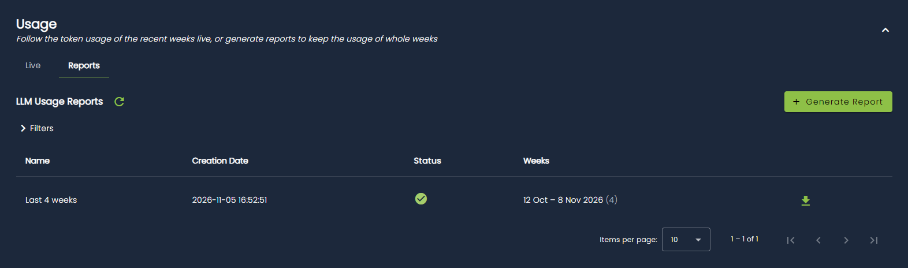
  <figcaption>Reports tab with the list of reports</figcaption>
</figure>


### Read the usage

The live usage and the details of a report have the same layout. The header shows the covered days or weeks, the number of projects, tasks, modules, module reports, and jobs with usage, and when the usage was computed.

#### Filters

Select **Filters** to open the filters panel. The available filters depend on the view:

| View | Filters |
| --- | --- |
| Company | Project, Task, Module, Model, Credential |
| Project | Task, Module, Model, Credential |
| Task | Module, Model, Credential |

Every option shows its tokens. Filters apply to every block of the page without generating the report again. Active filters are shown as chips next to the **Filters** button: remove a single chip, or select **Clear all**.

<figure markdown>
  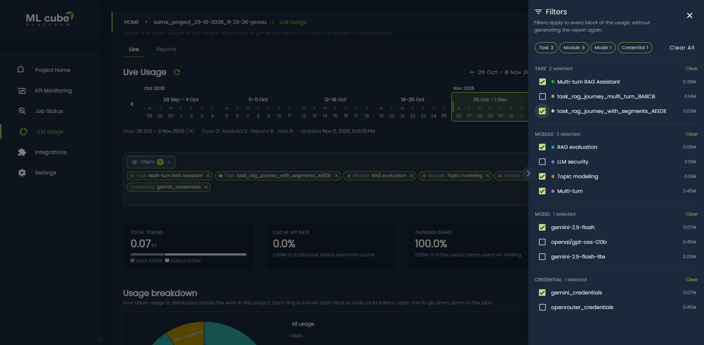
  <figcaption>Filters panel</figcaption>
</figure>

#### Summary tiles

| Tile | Meaning |
| --- | --- |
| **Total tokens** | Input plus output tokens, in millions, with the input and output split. |
| **Cache hit rate** | The share of input tokens read from the provider cache. |
| **Thinking share** | The share of output tokens spent on thinking. |
| **LLM calls** | The number of calls to the provider, the number of jobs, and the average tokens per call. |

#### Usage breakdown

A sunburst chart of how the tokens are distributed across the work: each ring is a level, and each slice is as wide as its tokens. Click a slice to drill down, down to the single jobs. In the project and company views, choose the order of the levels, for example **By project** (project, task, module) or **By module** (module, project, task) in the company view.

<figure markdown>
  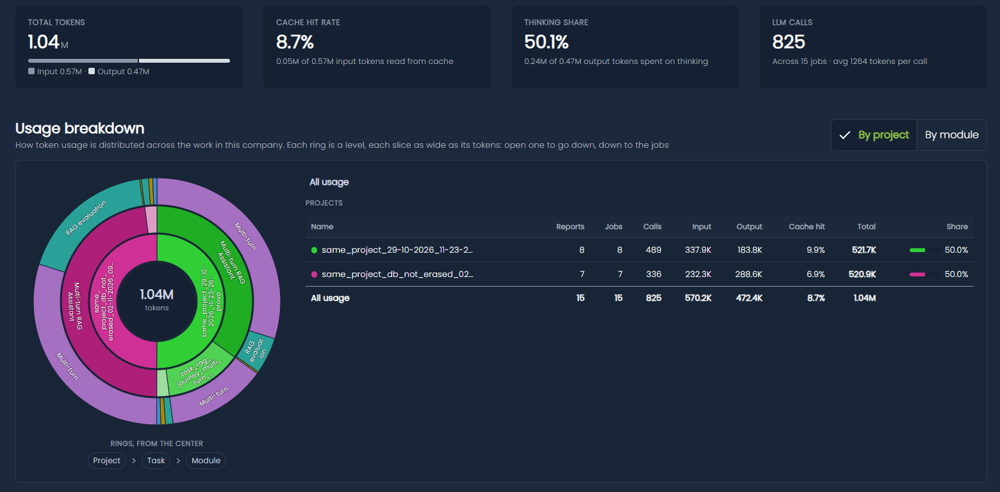
  <figcaption>Summary tiles and usage breakdown</figcaption>
</figure>

#### Weekly usage / Daily usage

A bar chart of the usage of each week, from Monday to Sunday, or of each day. Use the toggle to switch between the two:

- **Color by** colors the bars by module or task, and also by project in the company view. Click a legend item to show only that item, and click it again to show all of them.
- In the weekly view of a task or project, a line shows the task or project limit of each week. Clear **Show limits** to scale the chart to the usage only. The company view has no limits.

In the task and project views, expand **Week details** to see, for every week, the tokens shown with the current filters, the week total, the limit, the share of the limit used, and the status:

| Status | Meaning |
| --- | --- |
| **Within limit** | Less than 80% of the limit is used. |
| **Near limit** | At least 80% of the limit is used. |
| **Limit reached** | The whole limit is used. |
| **No limit** | No limit applies to the week. |

<figure markdown>
  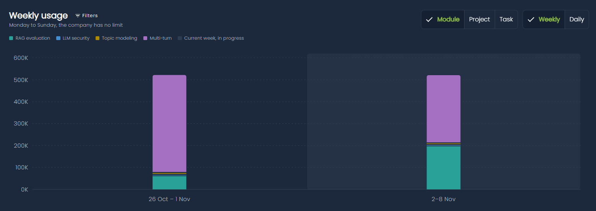
  <figcaption>Weekly usage at company level</figcaption>
</figure>


#### Where the tokens go

The token types as reported by the LLM provider, which can be split by module, task, or project:

| Token type | Meaning |
| --- | --- |
| **Normal input** | Input tokens processed normally. |
| **Cache creation** | Input tokens written to the provider cache. |
| **Read from cache** | Input tokens read from the provider cache. |
| **Response** | Output tokens of the answer. |
| **Thinking** | Output tokens spent on reasoning. |

!!! tip
    Cached input and thinking output are usually priced differently from normal tokens. Check them against your provider's pricing.

<figure markdown>
  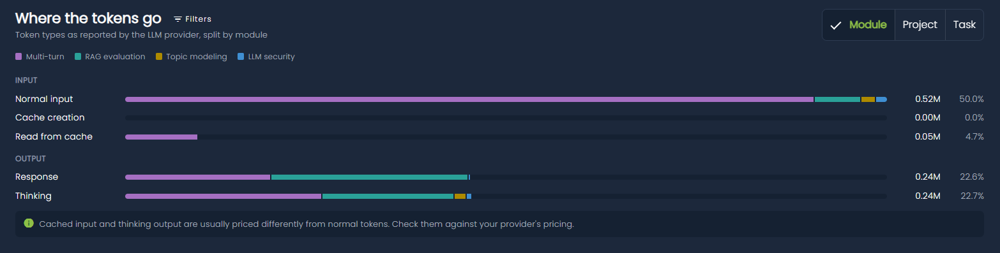
  <figcaption>Where the tokens go bars</figcaption>
</figure>


#### Technical breakdown

The usage **By model**, the model used in each LLM call, and **By credential**, the LLM integration credential used to call the provider.

<figure markdown>
  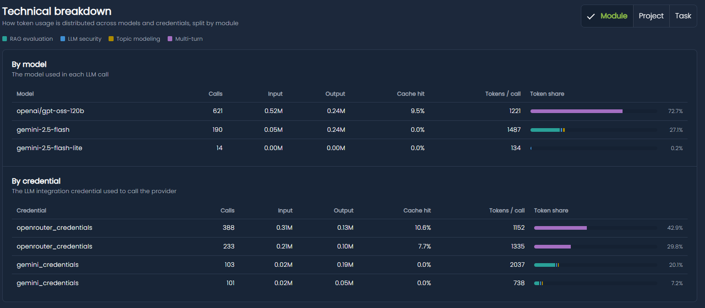
  <figcaption>Technical breakdown highlighting models and credentials</figcaption>
</figure>


### Export a report

A completed report can be exported from the export button in its row when the Export feature is enabled. The export contains one Parquet file with a row for every day, task, job, model, and credential, with the token counts by type and the names of the task, project, job module report, and credential.

- A **task** report is exported like any other report, see [Export a single report](modules/exports.md#export-a-single-report). Task reports are also listed when creating an export by report in the task's **Exports** page.
- A **project** or **company** report produces **one export per task**, each with the usage of its task only, also for the tasks without usage. The window lists the download links of every task export once they are ready; the exports are also listed in the **Exports** page of each task until they expire.

<figure markdown>
  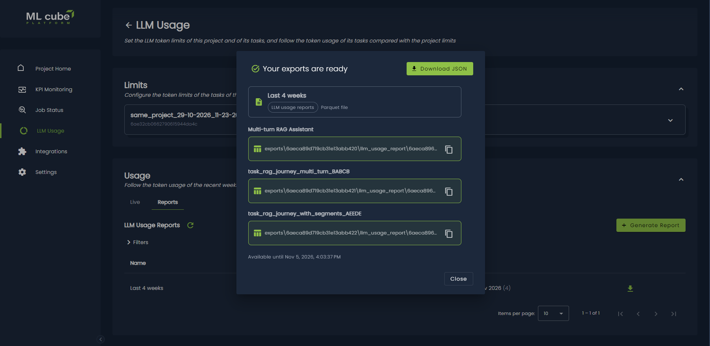
  <figcaption>Per-task exports of a project report</figcaption>
</figure>

## SDK

The usage and the reports can also be managed with the [Python SDK](../api/python/client.md#get_task_llm_usage_reports). Each operation exists at task, project, and company level:

- `get_task_llm_usage_live`, `get_project_llm_usage_live`, and `get_company_llm_usage_live` compute the live usage of a range of at most 28 days, by default the previous week and the current one.
- `create_task_llm_usage_report`, `create_project_llm_usage_report`, and `create_company_llm_usage_report` generate a report from the Monday `from_date` to the Sunday `to_date`, and return its identifier.
- `get_task_llm_usage_reports`, `get_project_llm_usage_reports`, and `get_company_llm_usage_reports` return the reports, newest first.
- `get_task_llm_usage_report`, `get_project_llm_usage_report`, and `get_company_llm_usage_report` return the details of a report.
- `create_project_llm_usage_report_exports` and `create_company_llm_usage_report_exports` export a completed report with one export per task. A task report is exported with `create_export`, see [Exports](modules/exports.md#sdk).

??? code-block "SDK Example"

    The following code generates a report of the last four weeks of a project and exports it.

    ```python
    from datetime import date, timedelta

    from ml3_platform_sdk.enums import LLMUsageReportStatus

    today = date.today()
    current_monday = today - timedelta(days=today.weekday())

    report_id = client.create_project_llm_usage_report(
        project_id=project_id,
        name='Last 4 weeks',
        from_date=current_monday - timedelta(weeks=3),
        to_date=current_monday + timedelta(days=6),
    )

    # Once the report is completed
    report = client.get_project_llm_usage_report(
        project_id=project_id, report_id=report_id
    )
    if report.status == LLMUsageReportStatus.COMPLETED:
        task_exports = client.create_project_llm_usage_report_exports(
            project_id=project_id, report_id=report_id
        )
        for task_export in task_exports:
            print(task_export.task_name, task_export.export_id)
    ```
