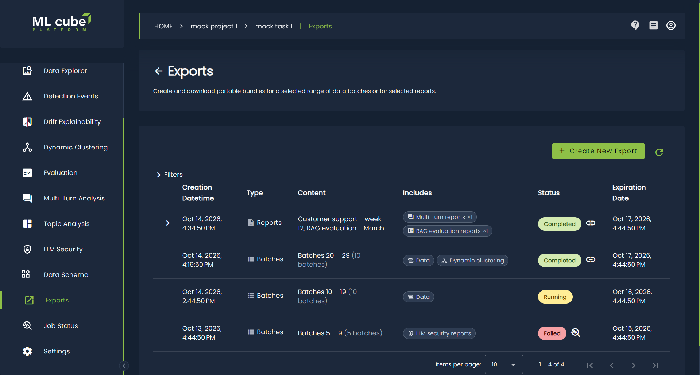
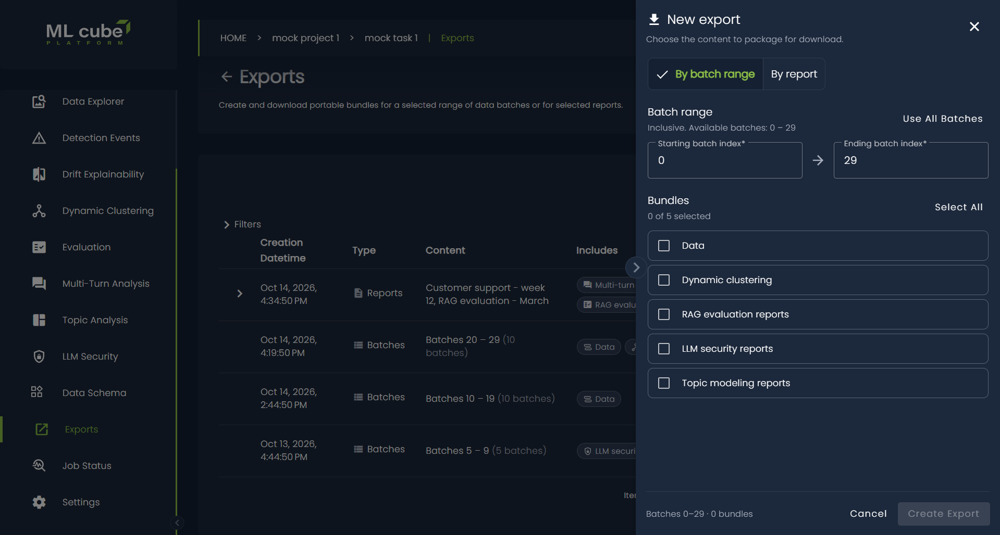
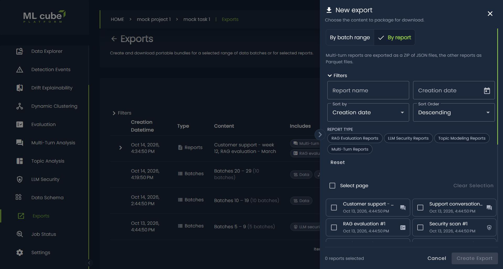
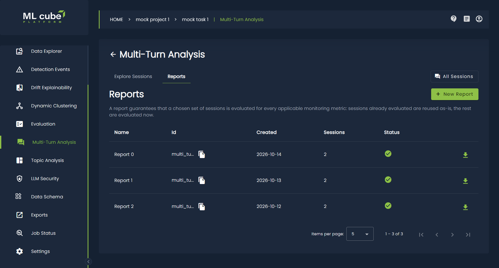
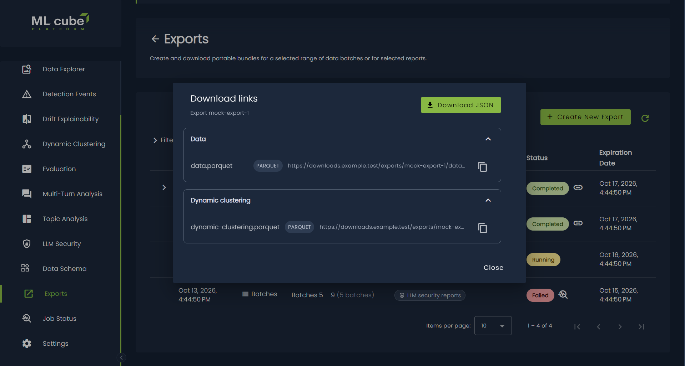

# Exports

Exports package task data and analysis results into portable files that can be
used outside ML cube Platform. An export selects its content in one of two
ways:

- **By batch range**: one or more content bundles for an inclusive range of
  [data batches].
- **By report**: a list of specific reports, of any type and in any number,
  chosen independently of the data batches.

Open a task and select **Exports** from the task menu. The page is available
when the Export feature is enabled for the platform and the company
subscription. Users with read access to the project can view exports and obtain
download links; creating an export requires permission to work on the project.

<figure markdown>
  
  <figcaption>Exports created for a task.</figcaption>
</figure>

## Bundles

A bundle is a family of related content, not necessarily a single file. The
bundles offered when creating an export by batch range depend on the task type,
its data structure, the enabled modules, and the company subscription.

| Bundle | Contents and availability |
| --- | --- |
| **Data** | Task samples from the selected batches in Parquet format. For image tasks, the bundle can also contain ZIP archives of images and novelty heatmaps when they are available. |
| **Dynamic clustering** | Available for tasks other than time-series tasks. It can contain [Dynamic clustering] results, transition results, and active microcluster results in Parquet format. Only results available for the selected range are included. |
| **RAG evaluation reports** | Available for RAG tasks when [RAG evaluation] is enabled. It contains evaluation metrics from reports covered by the selected batches in Parquet format. |
| **LLM security reports** | Available for RAG tasks when [LLM Security] is enabled. It contains the available security report results for the selected range in Parquet format. |
| **Topic modeling reports** | Available for text tasks when [Topic Analysis] is enabled. It contains the available topic modeling results for the selected range in Parquet format. |

Selecting a bundle does not guarantee that every possible file in that bundle
will be produced. Files are generated only for data or analysis results that
exist in the selected batch range. An export can therefore complete with fewer
files than expected, or with no downloadable files.

## Report types

When exporting by report, each selected report produces its own file.

| Report type | Format | Availability |
| --- | --- | --- |
| **RAG evaluation reports** | Parquet file | RAG tasks with [RAG evaluation] enabled. |
| **LLM security reports** | Parquet file | RAG tasks with [LLM Security] enabled. |
| **Topic modeling reports** | Parquet file | Text tasks with [Topic Analysis] enabled. |
| **Multi-turn reports** | ZIP archive of JSON files | RAG and AI Agents tasks configured as multi-turn, when monitoring is included in the subscription. See [Multi-Turn Analysis]. |

A multi-turn report archive contains a `summary.json` file with the report
summary and, for every session in the report, one JSON file per turn with its
analysis, under `sessions/<session id>/`.

!!! note
    Multi-turn reports can be exported only by report: they are not available
    as a bundle in a batch range export.

Only completed reports whose results are stored can be exported. If a selected
report is deleted after the export is created, the export still completes but
contains no file for that report.

## Create an export

1. Open the task and select **Exports**.
2. Select **Create new export**. The **New export** panel opens on the side of
   the page.
3. Choose **By batch range** or **By report** and fill in the selection, as
   described below.
4. Check the summary at the bottom of the panel, then select **Create export**.

The toggle between the two modes is shown only when the task has reports that
can be exported. If the task has no data batches, only the export by report is
offered. Only the fields of the selected mode are validated and sent.

If the request fails, the panel stays open so the same selection can be
submitted again. Closing the panel by clicking outside it keeps the current
selection, which is restored when **Create new export** is selected again.

<figure markdown>
  
  <figcaption>Select an inclusive batch range and the bundles to export.</figcaption>
</figure>

### By batch range

1. Enter the **Starting batch index** and **Ending batch index**. Both ends of
   the range are included. Select **Use all batches** to fill in the full
   range, from batch `0` through the highest available batch index.
2. Select one or more **Bundles**. Use **Select all** to select every available
   bundle, or **Clear** to deselect them.

Both indices must be non-negative whole numbers, neither can exceed the maximum
shown in the panel, and the ending index cannot be lower than the starting
index. The summary shows the selected range and the number of bundles, for
example `Batches 0–4 · 3 bundles`.

### By report

The panel lists the task reports that can be exported. Each entry shows the
report name, its creation date, and an icon for its report type.

1. Narrow the list if needed:
    - **Report name** shows the reports whose name contains the entered text,
      ignoring case.
    - **Creation date** shows the reports created in the selected date range.
    - **Report type** chips, shown when the task has more than one report type,
      restrict the list to the selected types. With no chip selected, every
      type is shown.
    - **Sort by** orders the list by **Creation date** (the default),
      **Name**, or **Report type**, and **Sort Order** sets ascending or
      descending order. Newest reports are shown first by default.
2. Select the reports to export. Use **Select page** to select or deselect all
   the reports on the current page, and **Clear selection** to start over.

The selection is kept when changing page or filters, so reports from different
pages, types, and dates can be combined in one export. The summary shows how
many reports are selected. Use the **Reset** action of the filters to clear
them.

<figure markdown>
  
  <figcaption>Select the reports to export.</figcaption>
</figure>

Export generation runs in the background. After the request is accepted, the
panel closes and the list is reloaded, with the new export at the top in the
**in queue** status. Select the **Reload exports** icon to load its latest
status; the list does not update automatically.

## Export a single report

A single report can also be exported directly from the module page where it is
listed. The export button is in the actions column of the reports table of the
[RAG evaluation], [LLM Security], [Topic Analysis], and [Multi-Turn Analysis]
pages. It is available once the report is completed, and it is hidden when the
Export feature is not enabled.

1. Select the export icon in the row of the report.
2. Review the report name, type, and file format, then select **Export**.
3. Wait while the export progresses through the **Queued**, **Processing**, and
   **Ready** steps.
4. When the export is ready, copy the download link of the file, or select
   **Download JSON** to save the link manifest.

The window can be closed at any time: the export keeps running and is listed in
the Exports page, like any other export by report. Select **View all exports**
to open that page. If the export takes more than five minutes, the window stops
waiting and offers **Go to Exports**. If the export fails, the window shows the
reason and offers **Retry**.

<figure markdown>
  
  <figcaption>Export a single report from its module page.</figcaption>
</figure>

## Export statuses

| Status | Meaning | Available action |
| --- | --- | --- |
| **in queue** | The export request is waiting to be processed. | Reload the list later. |
| **running** | The selected content is being collected and written. | Reload the list later. |
| **completed** | Processing finished. | Generate download links before the expiration date. |
| **failed** | Processing stopped because of an error. | Select the error-details icon to read the failure message. |
| **expired** | The export has passed its retention period. | Create a new export if the files are still needed. |

Each export has an **Expiration date**. Exported files are retained for three
days from the export's creation time. After that date the export is shown as
**expired** and its files can no longer be downloaded.

!!! note
    A failed export cannot be resumed from the list. Review its error details,
    correct the underlying data or module issue when possible, and create a new
    export.

## Download exported files

Download links can be generated only for a completed export that has not
expired.

1. Find the completed export in the list.
2. Select the link icon in the **Status** column.
3. In the **Download links** dialog, expand or collapse each bundle group as
   needed.
4. Select the copy icon beside a file and open the copied URL to download that
   file.

The dialog identifies every file by its bundle name and file type. Select
**Download JSON** to save all the displayed links and their metadata in a file
named `export-<export-id>-links.json`. This JSON file is a link manifest; it does
not contain the exported data itself.

Replace this comment with:
<figure markdown>
  
  <figcaption>Download links grouped by bundle.</figcaption>
</figure>

!!! warning
    Download links provide direct access to exported task content. Treat them as
    sensitive, share them only with authorized recipients, and do not place them
    in public tickets, chat rooms, or source repositories. Generated links may
    stop working before the export itself expires; generate a fresh set from the
    completed export when needed.

## Find an export

Exports are listed from newest to oldest. Each row shows:

- **Type**: **Batches** for exports by batch range, **Reports** for exports by
  report.
- **Content**: the batch range and the number of batches, or the names of the
  included reports. When there are more than two reports, the remaining ones
  are summarized as `+N`; hover over it to read their names.
- **Includes**: the exported bundles, or the report types with the number of
  reports of each type.
- **Status** and **Expiration date**.

Expand a report export with the arrow at the start of its row to see every
included report with its type and file format.

Use the filters to narrow the history:

- **Type** shows only exports by batch range (**Batches**) or by report
  (**Reports**).
- **Includes** shows the exports that contain at least one of the selected
  bundles or report types. When **Type** is set to **Reports**, the filter is
  named **Report types** and offers only report types.
- **Report name** shows the report exports that include a report whose name
  contains the entered text, ignoring case.
- **Creation date** includes exports created on any day in the selected date
  range.
- **Starting batch index** includes exports whose starting index is equal to or
  greater than the entered value.
- **Ending batch index** includes exports whose ending index is equal to or
  lower than the entered value.
- **Active exports only** is selected by default and hides exports whose
  expiration date has passed. Clear it to include the full export history.

When both batch filters are set, the results are exports whose complete batch
range fits within those boundaries. Filters that cannot apply to the selected
type are cleared and disabled: the batch filters for report exports, and
**Report name** for batch range exports. Select **Apply Filters** to update the
list or **Reset** to restore the defaults. Use the paginator to change pages or
the number of rows shown.

## Troubleshooting

- **Exports is missing from the task menu**: confirm that the Export feature is
  enabled for the platform and included in the company subscription.
- **No bundles are available**: bundle availability depends on the task type,
  data structure, enabled modules, and subscription. The Data bundle is offered
  when exporting is available.
- **The By report option is missing**: the task has no report type that can be
  exported. Confirm that the relevant module is enabled and has produced
  reports.
- **A report is not listed**: only completed reports whose results are stored
  can be exported. Also check the report name, date, and type filters.
- **Create export is unavailable**: for a batch range export, confirm that the
  task has at least one data batch, both indices are valid, and at least one
  bundle is selected. For a report export, confirm that at least one report is
  selected. Also confirm that you have permission to work on the project.
- **The export button of a report is disabled**: the report is not completed
  yet.
- **The new export remains in queue or running**: wait for processing to finish,
  then select the **Reload exports** icon to retrieve the latest status.
- **An export failed**: select its error-details icon for more information, then
  create a new export after resolving the cause.
- **A completed export has no links**: none of the requested data or analysis
  artifacts were available in the selected batch range, or the selected reports
  were deleted after the export was created. Try another range or selection, or
  confirm that the relevant module has produced results.
- **A download link does not work**: the link itself may have expired. Generate
  the links again while the export is active. If the export's expiration date
  has passed, create a new export.
- **Expected exports are missing**: clear **Active exports only**, reset the
  other filters, and check additional result pages.

## SDK

Exports can also be managed with the [Python SDK]:

- `get_export_creation_options` returns the bundles and report types available
  for a task, and its highest batch index.
- `get_exportable_reports` returns a page of the reports that can be exported,
  with the same filters and sorting offered in the web app.
- `create_export` creates an export. Set `export_type` to
  `ExportType.BATCH_RANGE` with a batch range and `bundles`, or to
  `ExportType.REPORT` with a list of `ExportReportSelection` in `reports`.
- `get_exports` returns a page of the task exports, with the same filters
  offered in the web app.
- `get_export_download_links` returns the download links of a completed export.

??? code-block "SDK Example"

    The following code exports the three most recent reports of a task.

    ```python
    from ml3_platform_sdk.enums import ExportType
    from ml3_platform_sdk.models import ExportReportSelection

    reports = client.get_exportable_reports(task_id=task_id, page_size=3)

    export_id = client.create_export(
        task_id=task_id,
        export_type=ExportType.REPORT,
        reports=[
            ExportReportSelection(
                report_type=report.report_type,
                report_id=report.report_id,
            )
            for report in reports.items
        ],
    )

    # Once the export is completed
    links = client.get_export_download_links(task_id=task_id, export_id=export_id)
    ```

[Data batches]: ../data.md#data-batch
[Dynamic clustering]: dynamic_clustering.md
[RAG evaluation]: rag_evaluation.md
[LLM Security]: llm_security.md
[Topic Analysis]: topic_modeling.md
[Multi-Turn Analysis]: multi_turn.md
[Python SDK]: ../../api/python/client.md#create_export
